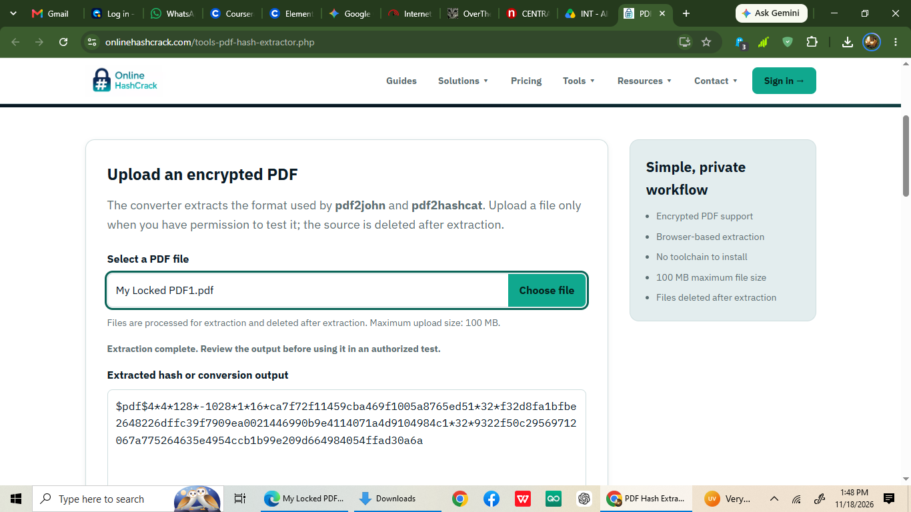

# 🔐 NETWORKWALKS - WEEK 3: PDF HASH EXTRACTION & PASSWORD CRACKING

**Program:** Cybersecurity Internship @ Networkwalks  
**Author:** Orifa Miracle Oyimafu  
**Module:** WK3-PM2 - Cryptographic Hashing, Dictionary Attacks & Password Recovery  
**Instructor:** Sir Waqas Karim (CCIE)  

---

## 📌 Project Overview
This project demonstrates practical cryptographic hash extraction and offline dictionary-based password recovery on encrypted PDF documents. Using a combination of browser-based hash extractors, **Johnny** (the GUI frontend for John the Ripper), and **Networkwalks Security Tools**, four password-protected PDF files were analyzed, cracked, and unlocked to capture embedded flags.

---

## 🧰 Tools & Technologies Used
* **Networkwalks Hash Calculator:** Local browser-based extraction of `$pdf$` hashes in `pdf2john` / `hashcat` compatible format[cite: 26].
* **OnlineHashCrack (PDF Hash Extractor):** Automated conversion of encrypted PDF structures into crackable hash strings[cite: 32].
* **Johnny (John the Ripper GUI):** Offline password auditing and wordlist-based hash cracking.
* **Networkwalks Password Cracker:** Web-based dictionary attack lab simulating wordlist matching against extracted PDF hashes.

---

## 🛠️ Step-by-Step Execution & Flag Capture

### Phase 1: Cryptographic Hash Extraction
To audit the encrypted PDFs without directly brute-forcing the document viewer, the cryptographic metadata hashes were first extracted:

1. **Using Networkwalks Hash Calculator:**
   - Loaded `My Locked PDF2.pdf` into the local parser[cite: 26].
   - Extracted the 128-bit RC4/AES revision hash (`$pdf$4*4*128*...`) ready for cracking[cite: 26].

2. **Using OnlineHashCrack PDF Extractor:**
   - Uploaded `My Locked PDF1.pdf` to extract its corresponding `$pdf$` hash string for cross-verification[cite: 32].

---

### Phase 2: Offline Dictionary Attack with Johnny (John the Ripper)
1. Imported the extracted `$pdf$` hashes into **Johnny**[cite: 27].
2. Configured the format to `PDF` and initiated a dictionary attack[cite: 27].
3. Successfully recovered the plaintext password **`good-luck`** for `My Locked PDF2.pdf`[cite: 27].

---

### Phase 3: Dictionary Attack via Networkwalks Password Cracker
1. Pasted the extracted hash from `My Locked PDF1 (for NW Tools Lab WK3-PM2).pdf` into the **Networkwalks Password Cracker** lab[cite: 28, 33].
2. Executed the automated wordlist attack, matching the hash at attempt 35 to recover the password **`1qaz2wsx`**.

---

## 🚩 Captured Flags & Verification

Using the recovered passwords, all four target PDF files were unlocked and verified:

| Target Document | Recovered Password / Method | Captured Flag |
| :--- | :--- | :--- |
| `My Locked PDF1.pdf` | Johnny / Hash Extractor | `nw{cybersecurity_flag_captured_2608}`[cite: 29, 32] |
| `My Locked PDF2.pdf` | `good-luck` (Johnny)[cite: 27] | `nw{networkwalks_persistence_jtr_270521}`[cite: 30] |
| `My Locked PDF3.pdf` | Johnny / Dictionary Attack | `nw{networkwalks_flag_260821_1}`[cite: 31] |
| `My Locked PDF1 (NW Tools).pdf`[cite: 28] | `1qaz2wsx` (NW Password Cracker)[cite: 33] | `nw{networkwalks_flag1_jtr_270521_1}`[cite: 28] |

### Unlocked Document Proofs:

**1. My Locked PDF1:**

**2. My Locked PDF2:**

**3. My Locked PDF3:**

**4. My Locked PDF1 (Networkwalks Tools Lab):**

---

## 💡 Key Security Takeaways
* **Why Weak Passwords Fail Offline:** Once an attacker extracts a file's cryptographic hash (`$pdf$`), password verification happens entirely offline at high speeds—bypassing viewer lockout limits.
* **Wordlist Vulnerability:** Common patterns and keyboard walks (such as `1qaz2wsx`[cite: 33] or dictionary phrases like `good-luck`[cite: 27]) are cracked within seconds using standard wordlists.
* **Defensive Mitigation:** Sensitive documents must be protected with high-entropy, randomly generated passphrases (14+ characters) and modern AES-256 encryption standards.

---

## 👨‍🏫 Acknowledgments
Special thanks to **Sir Waqas Karim (CCIE)** and the **Networkwalks IT Solutions & Training** team for the hands-on labs and practical guidance throughout Week 3.
